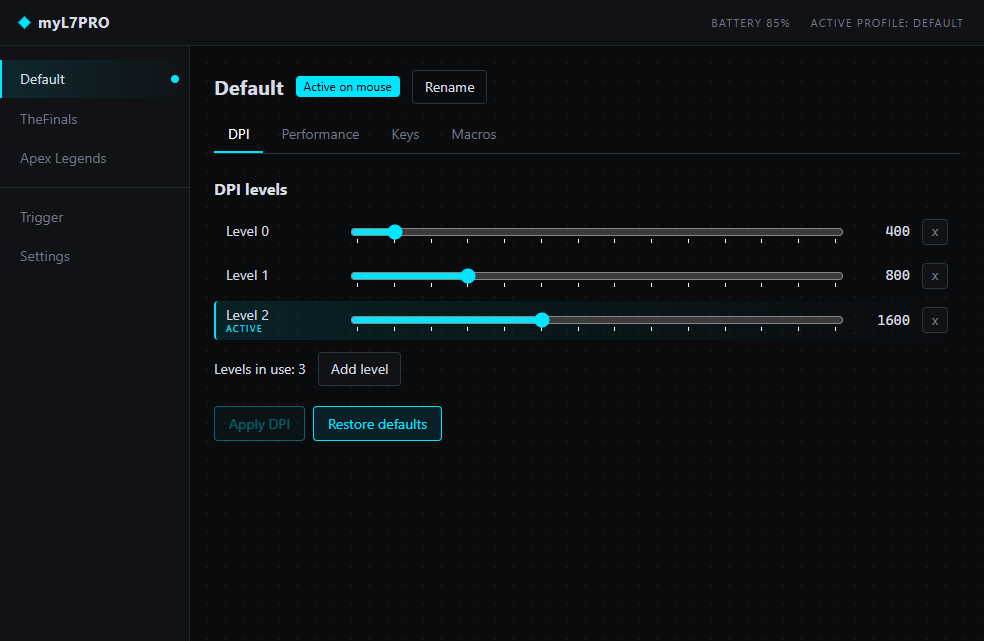
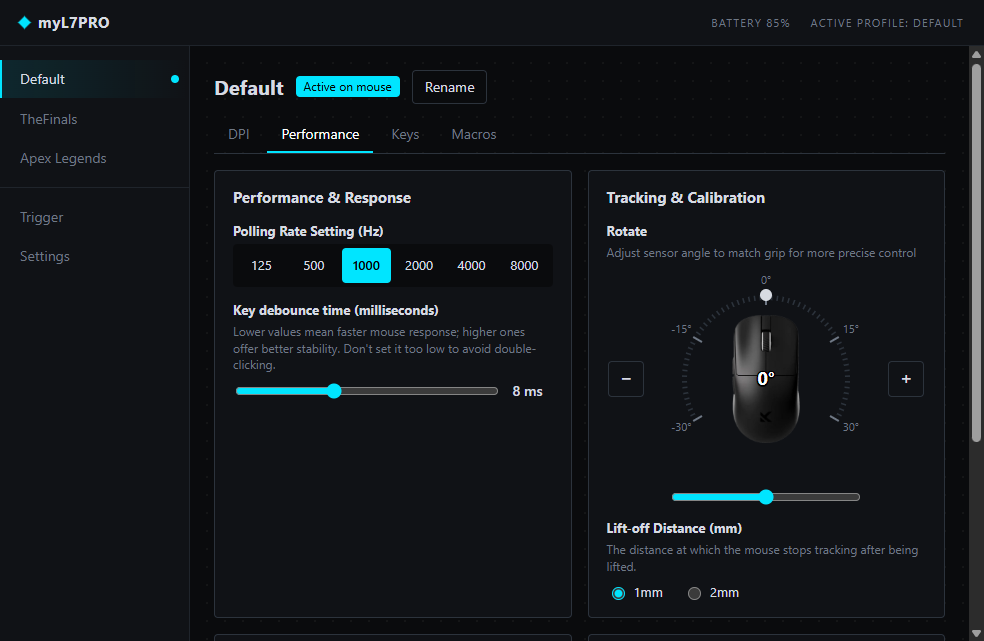
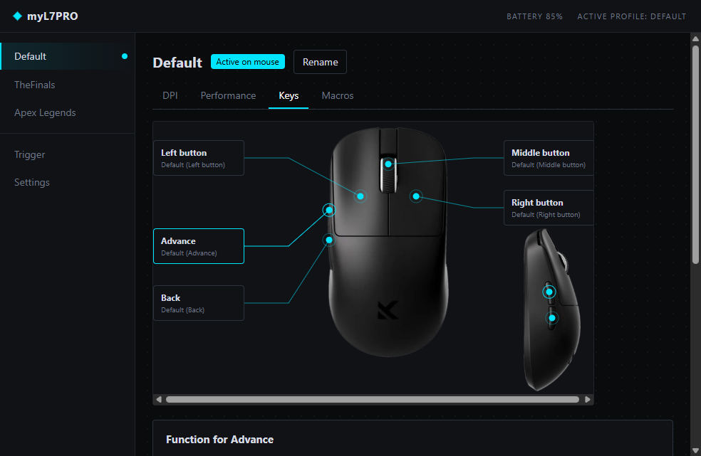
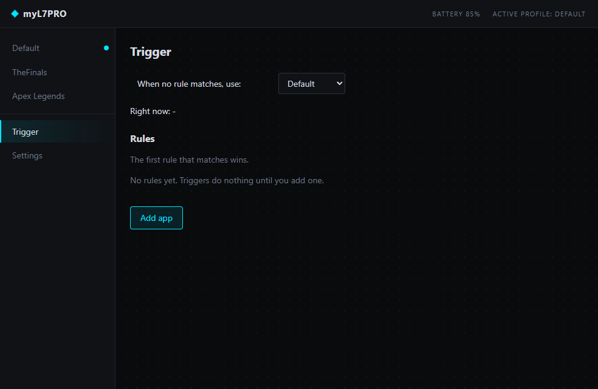
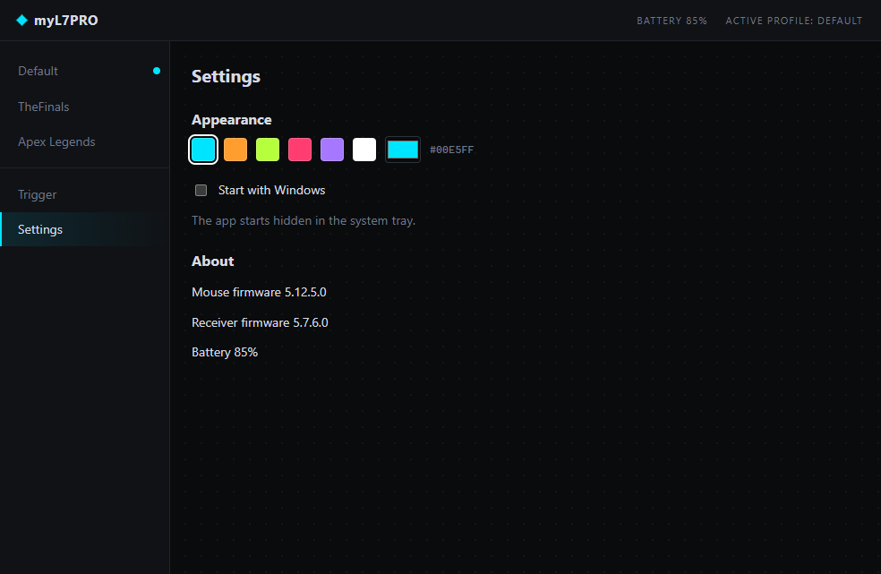

# myL7PRO

An open, offline desktop app for the **MCHOSE L7 Pro** mouse. It replaces the day-to-day use of the official M HUB web driver, and it can switch the mouse profile by itself depending on the program you are using.

> Unofficial project, not affiliated with MCHOSE. Use it at your own risk. Product photos belong to their respective owners.

Status: **Windows first**. Linux is planned.

## Screenshots

| DPI levels, active level highlighted | Performance |
|---|---|
|  |  |

| Key assignment | Trigger (profile per app) |
|---|---|
|  |  |

| Settings (accent color, start with Windows, firmware info) |
|---|
|  |

## What it does

- **Profiles:** shows the 3 onboard profiles, switches between them, renames them.
- **Trigger:** automatically switches the mouse profile when a chosen program is in the foreground (for example a game), and goes back to your normal profile afterwards. With no rules, it does nothing.
- **DPI:** up to 6 levels from 200 to 26000, add and remove levels, restore defaults. The level currently in use is highlighted.
- **Performance:** polling rate (up to 8000 Hz with the 8K dongle), key debounce time, sleep timer, lift-off distance, ripple control, angle snapping, motion sync and sensor rotation.
- **Keys:** assign mouse buttons, DPI +/switch, multimedia keys, keyboard keys with modifiers, edit actions, or disable a button. The app refuses to remove the last left click.
- **System tray:** lives in the tray, starts hidden with Windows (you can turn this off in Settings).
- **Appearance:** dark design with an accent color of your choice.
- **Private:** no network access and no telemetry. Settings stay on your PC.

## What it does not do

- **It does not update the firmware.** This is deliberate: a bad firmware write can brick the mouse. To update the firmware, keep using the official M HUB.
- **It does not factory-reset the mouse.** Also deliberate, for the same reason.
- Not available yet: macros, separate X/Y DPI, profiles stored on the PC with import/export, lighting (the L7 Pro has none in M HUB), Linux.

Because every setting is written to the mouse's own memory, the app does not need to be running for your profiles, DPI and keys to keep working. The app only needs to run for the Trigger feature.

## Install

1. Download `myL7PRO-Setup-<version>.exe` from the [Releases](https://github.com/Bagareal/myL7PRO/releases) page.
2. Run it. The installer is not code-signed, so Windows SmartScreen may warn you: click **More info**, then **Run anyway**.
3. The app starts hidden in the system tray and opens its window from the tray icon.

To update, download the newer installer and run it over the old one.

## Safety

The app talks to the mouse over USB HID through the receiver. It only sends commands that were captured from the real M HUB and compared byte by byte. Commands that are not understood, firmware updates and factory reset are never sent. The protocol notes are in [PROTOCOL.md](PROTOCOL.md).

## Development

Requirements: Node.js 22 and a Windows PC with the mouse receiver connected.

```
cd l7pro
npm install
npm run app        # development
npm test           # unit tests
npm run check      # type check
npm run dist       # build the Windows installer into l7pro/release
```

Pushing a tag such as `v1.0.5` builds the installer on GitHub and publishes a release.
